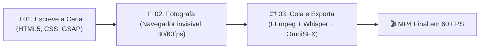
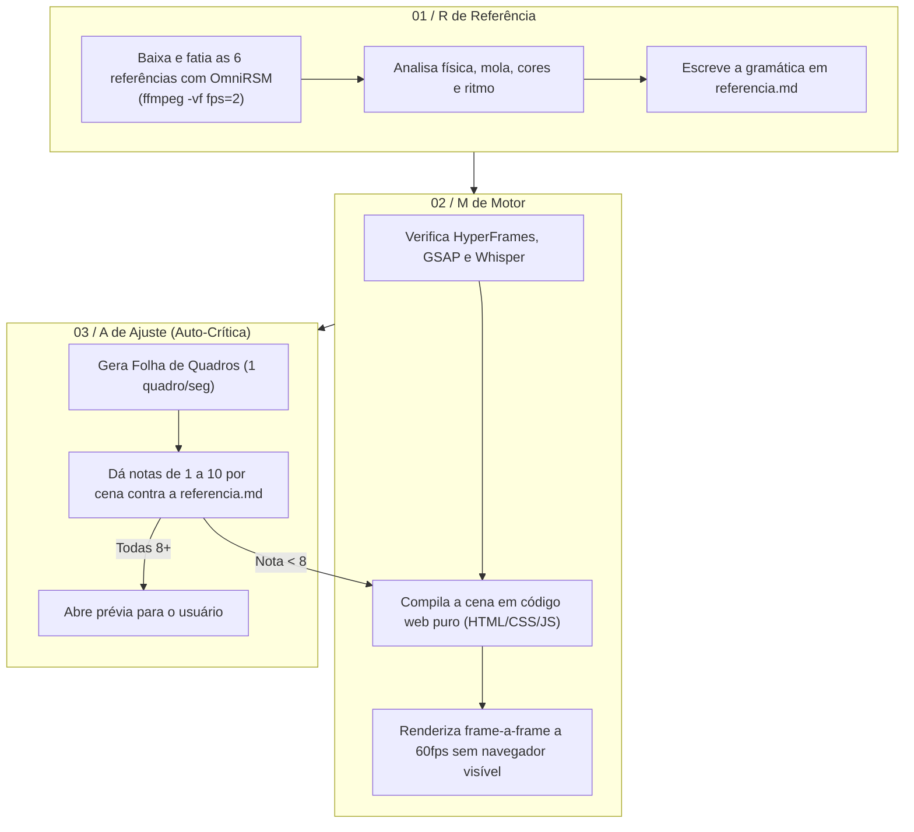

# 🎬 OmniMotion — Motor Universal de Motion Graphics & Método RMA
> 🇧🇷 **Inspirado no Método RMA (Referência, Motor, Ajuste) de Felipe Tâmbara & Max Carrau (Core Comunidade)**  
> Totalmente integrado ao ecossistema: **OmniCreator**, **OmniRSM**, **OmniSFX** e o arsenal **Motion Machine Tools** (`motion-machine-tools.md`).

---

## 🧭 Tese Central: A IA não abre editor. Ela *escreve* o vídeo.

O agente de IA não clica em timeline nem arrasta keyframes na mão. Ele **descreve cada cena em código web**, e um motor local transforma esse código em quadros de alta resolução a 60 FPS:



> **Consequência direta:** O vídeo inteiro é código e texto. Portanto, ajusta-se em português simples: *"Sobe esse card no segundo 2"*, *"tira o fade do título e coloca corte seco"*, *"ajusta a mola igual à referência"*.

---

## 🛠️ Arsenal Integrado (Motion Machine Tools)

A skill incorpora as 6 ferramentas de ponta mapeadas no documento [`motion-machine-tools.md`](file:///C:/Users/limae/Documents/Recreativo/Resume/rsm-intel/motion-machine-tools.md):

| Ferramenta / Engine | Papel na OmniMotion | Como é Acionada |
| :--- | :--- | :--- |
| **[HyperFrames](https://github.com/heygen-com/hyperframes)** | Motor Principal de Renderização Web para Vídeo | `npx hyperframes preview` e `npx hyperframes render` |
| **[AThevon/genjutsu](https://github.com/AThevon/genjutsu)** | Física de Mola, Easing e Design Systems para Motion | Aplica curvas spring (stiffness/damping) e micro-interações |
| **[shinyobjectz/raea](https://github.com/shinyobjectz/raea)** | RAEA (Rust + Bevy) para render ultrarrápido na GPU nativa | Engine secundária de alta densidade gráfica e 3D |
| **[Remotion](https://github.com/remotion-dev/remotion)** | Framework React para vídeos paramétricos e automações | Templates dinâmicos e composição React/TypeScript |
| **[OpenMontage](https://github.com/topics/motion-graphics)** | Tipografia Cinética, Data-Viz e Lower-Thirds | Textos com entrada em corte seco, máscaras e contadores |
| **FFmpeg + Playwright Headless** | Captura frame-a-frame a 60fps e mixagem final com áudio | Pipeline automatizado de exportação `.mp4` |

---

## 🧙‍♂️ Comando Mestre: `/motion:wizard` (Modo Entrevista Guiada)

Quando invocado com `/motion:wizard` ou `/motion:rma`, o agente **assume o comando e conduz o usuário passo a passo**. O usuário não precisa saber comandos técnicos nem sintaxe de código: ele apenas responde as etapas abaixo.

### 📋 As 5 Perguntas da Entrevista Sequencial:

```text
Passo 1 / 5 ──> [ 6 Mídias de Referência + O que te pegou ]
Passo 2 / 5 ──> [ Formato da Tela & Duração Alvo ]
Passo 3 / 5 ──> [ Conteúdo, Roteiro & Fala ]
Passo 4 / 5 ──> [ Identidade Visual & Regras Anti-Slop ]
Passo 5 / 5 ──> [ Sonoplastia & SFX ]
                     │
                     ▼
         [ Execução Autônoma RMA ]
```

#### Pergunta 1: O Banco de Referências (Até 6 mídias)
> *"Para que o motion não fique com cara de IA genérica, forneça de 1 a 6 mídias de referência (links do YouTube Shorts, TikTok, Instagram Reels, Dribbble, links do prompt-motion.com ou vídeos MP4 locais) e diga **em uma linha o que te pegou em cada uma** (ex: 'o card que entra em mola no segundo 3', 'o texto que nasce na palavra', 'o corte seco na batida')."*

#### Pergunta 2: Formato e Duração
> *"Qual o formato e a duração do vídeo?*  
> - **[A] 9:16 Vertical (Reels / TikTok / Shorts)** — 15s, 30s ou 60s  
> - **[B] 16:9 Horizontal (YouTube / Produto)** — 30s, 60s ou 90s  
> - **[C] 1:1 Quadrado (Feed / Carrossel em Vídeo)** — 15s ou 30s"*

#### Pergunta 3: Conteúdo e Roteiro
> *"O que vai aparecer no vídeo?*  
> - **[A]** Já tenho o texto exato / roteiro pronto (cole aqui).  
> - **[B]** Tenho o vídeo/áudio gravado com a minha fala (vou anexar o arquivo bruto para o Whisper transcrever com timestamps por palavra).  
> - **[C]** Quero que o **OmniCreator** gere agora o roteiro de alta retenção (`/creator:video`)."*

#### Pergunta 4: Estilo Visual & Paleta
> *"Qual é a vibe visual da peça?*  
> - **[A] Dark Minimalist / Linear / SaaS** (Fundo escuro sólido `#07081A`, 1 cor de destaque, tipografia Geist, zero degradê).  
> - **[B] Apple Clean / Light** (Fundo claro, cards com borda sutil, foco no produto).  
> - **[C] Brutalist / Cyber Terminal** (Monospace, bordas rígidas, alto contraste).*  
> *(Obs: O arquivo `gosto.md` será consultado automaticamente para resgatar suas preferências aprovadas em sessões anteriores)."*

#### Pergunta 5: Sonoplastia & SFX (OmniSFX)
> *"Como deve ser o áudio das transições?*  
> - **[A] Tech & Tátil** (Pops de mola, cliques de alumínio e whooshes sutis nos cards).  
> - **[B] Impacto & Beat-Sync** (Transições travadas na batida da trilha musical com risers).  
> - **[C] Silencioso / Só Voz** (Sem efeitos sonoros, apenas a fala limpa)."*

---

## 🔁 O Ciclo R M A na Prática

Após as respostas do usuário, o agente entra em **execução autônoma**:



---

## 🚫 Regras da Casa (Anti-AI Slop em Vídeo)

O agente **NUNCA** faz o seguinte:
- ❌ Título centralizado com degradê colorido de IA.
- ❌ Animar tudo entrando com fade preguiçoso (`opacity: 0 -> 1`). Use molas elásticas, máscaras de recorte ou cortes secos.
- ❌ Rótulos soltos flutuando nos cantos da tela sem função semântica.
- ❌ Mais de uma cor de destaque por cena.
- ❌ Blocos coloridos abstratos fingindo ser interface (mostre o app real, tweet real ou código real).
- ❌ Motion curto de enfeite (se não agrega retenção ou clareza, é deletado).

---

## 🧠 Memória de Gosto (`gosto.md`)

Ao final da entrega da peça:
- O agente pergunta o que você amou e o que você reprovou.
- As respostas são salvas no arquivo `gosto.md` no diretório do projeto.
- Na próxima invocação do `/motion:wizard`, o agente já carrega o `gosto.md` e aplica suas preferências automaticamente, encurtando o tempo de criação.

---

## 💻 Tabela Resumo de Comandos

| Comando | Descrição |
| :--- | :--- |
| **`/motion:wizard`** ou **`/motion:rma`** | **Inicia a entrevista guiada de 5 passos onde o usuário apenas responde.** |
| `/motion:init` | Verifica e instala ferramentas do motor local (HyperFrames, GSAP, FFmpeg, Whisper). |
| `/motion:ref` `[link/arquivo]` | Decompõe referências específicas e gera o `referencia.md`. |
| `/motion:build` | Constrói a cena e aciona o renderizador HyperFrames. |
| `/motion:sfx` | Insere os efeitos sonoros procedurais sincronizados frame-accurate. |
| `/motion:audit` | Gera folha de quadros e auto-avalia as cenas (nota 1 a 10). |
| `/motion:adjust` `[tempo] [ajuste]` | Recebe ajustes pontuais em português (ex: *"no 0:03, card entra em mola"*). |
| `/motion:taste` | Registra no `gosto.md` o que foi aprovado/reprovado. |
